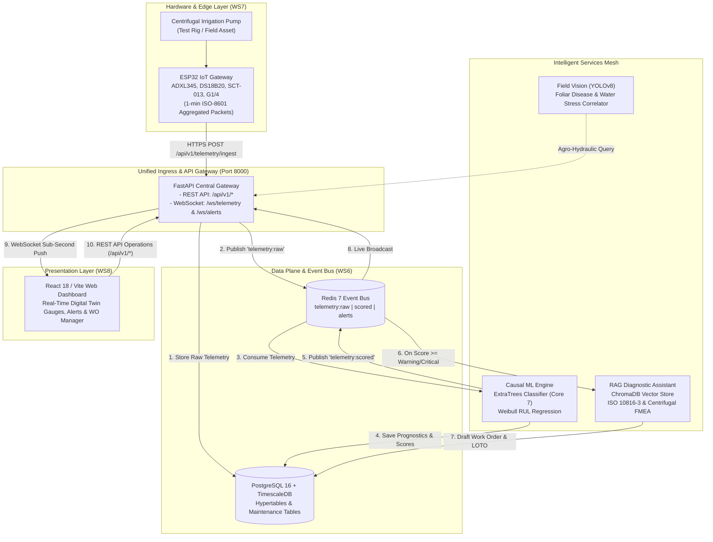

# AgriPulse — AI Predictive Maintenance for Smart Irrigation Pumps

> **Graduation Project — Artificial Intelligence Engineering Program**  
> **Faculty of Engineering, Mansoura University**  
> **Target Asset:** Industrial End-Suction Centrifugal Irrigation Pump (*Grundfos NB / Kirloskar DB Series*)  
> **Classification:** Class II Rotating Industrial Machinery under **ISO 10816-3** (15 kW – 75 kW)

[](https://www.python.org/)
[](https://pytorch.org/)
[](https://xgboost.readthedocs.io/)
[](https://fastapi.tiangolo.com/)
[](https://www.trychroma.com/)
[](#)

---

## 📌 Executive Summary

Modern pressurized irrigation networks, national reclamation initiatives (*New Delta, Toshka, Future of Egypt*), and large-scale agricultural schemes rely critically on centrifugal pumping stations. Unexpected mechanical breakdowns lead to devastating agricultural downtime (averaging **43.8 hours** and reaching up to **140.5 hours / 6 days** in historical telemetry), triggering crop loss, massive water waste, and exorbitant repair costs.

**AgriPulse** is an enterprise Cyber-Physical AI platform delivering **Prognostics and Health Management (PHM)**:
1. **Telemetry & Prognostic Risk Scoring:** Continuous monitoring across 52 hydraulic, electrical, and mechanical sensors with deep sequence learning and gradient boosted trees to deliver **6-to-12-hour pre-failure early warnings** and Remaining Useful Life (RUL) regression.
2. **Cognitive RAG Diagnostic Assistant:** An LLM-driven retrieval-augmented generation engine grounded in **ISO 10816-3**, manufacturer O&M manuals, and FMEA matrices that translates statistical anomalies into calibrated, actionable maintenance work orders with safety LOTO checklists.
3. **Multi-Modal Vision Pipeline:** Field camera integration (YOLOv8) correlating pump operational health with downstream crop canopy water stress.
4. **Hardware-in-the-Loop Testbed:** Benchtop ESP32 telemetry rig sampling vibration, temperature, current, and pressure to validate fault detection in real-world scenarios.

---

## 🧭 Master Documentation Navigator

The project documentation is organized hierarchically to serve university committees, system architects, data scientists, embedded hardware engineers, and software developers.

```
📁 AgriPulse Documentation Ecosystem
│
├── 📜 1. Academic & Executive Proposals
│   ├── docs/AgriPulse_Graduation_Project_Comprehensive_System.md   (Master Spec & Mansoura Univ Template)
│   ├── docs/AI_Predictive_Maintenance_System_—_Full_Project_Documentation.pdf (Sequential Plan T01–T67)
│   └── docs/AgriPulse (1).pdf                                      (Academic Thesis Proposal)
│
├── 🏗️ 2. Technical Architecture & Systems Engineering
│   ├── docs/tsnem/AI_Technical_Architecture.md                     (Full Production Architecture & Core 7 Specs)
│   ├── docs/tsnem/Hardware_Team_Reference.md                       (ESP32 Pinout, Local BOM & Fault Rig)
│   └── docs/tsnem/AI_Pipeline_Completion_Plan.md                   (Microservices Roadmap & Kaggle State)
│
├── 📊 3. Data Engineering & Telemetry Reports
│   ├── ml/reports/sensor_handling.md                               (Sensor Cleaning & Missingness Decisions)
│   ├── ml/reports/data_dictionary.md                               (1,053 Engineered Features Dictionary)
│   └── ml/reports/profile_report.json                              (220,320 Row Source Data Audit)
│
├── 🧠 4. Model Cards & Experimental Evaluations
│   ├── ml/models/v1/model_card.json                                (Production Model Card & Registry)
│   ├── ml/reports/t14_anomaly_baselines.json                       (IsoForest / PCA / Mahalanobis Baselines)
│   ├── ml/reports/t15_lstm_autoencoder.json                        (LSTM-AE Reconstruction Benchmarks)
│   ├── ml/reports/t16_t17_supervised_risk.json                     (Supervised XGBoost Early Warnings)
│   └── ml/reports/t19_rul_model.json                               (RUL Regression Horizon Evaluations)
│
└── 📑 5. Milestone & Supervisor Progress Reports
    ├── reports/AgriPulse_Progress_Report_v2.pdf                    (Official Progress Report for Supervisors)
    └── scripts/generate_progress_report.py                         (ReportLab PDF Generator Script)
```

### Detailed Document Directory

| Document | Focus / Domain | Target Audience | Key Contents & Purpose |
| :--- | :--- | :--- | :--- |
| [`docs/AgriPulse_Graduation_Project_Comprehensive_System.md`](docs/AgriPulse_Graduation_Project_Comprehensive_System.md) | **Master Academic Specification** | Supervisors, Reviewers | Official Mansoura Univ template (Arabic & English), national problem alignment, 14-week schedule, budget, pump physics, and multi-modal roadmap. |
| [`docs/AI_Predictive_Maintenance_System_—_Full_Project_Documentation.pdf`](docs/AI_Predictive_Maintenance_System_—_Full_Project_Documentation.pdf) | **Master Planning Document** | All Teams | Sequential roadmap detailing all 67 tasks (**T01 through T67**) across 8 workstreams (WS1–WS8). |
| [`docs/AgriPulse (1).pdf`](<docs/AgriPulse (1).pdf>) | **Thesis Proposal** | Academic Committee | Academic project proposal and baseline research framework. |
| [`docs/tsnem/AI_Technical_Architecture.md`](docs/tsnem/AI_Technical_Architecture.md) | **Production Technical Blueprint** | AI, Backend, MLOps | Target machine specifications (Grundfos NB / Kirloskar DB), Core 7 sensor mapping, ExtraTrees classifier, dual thresholds (`0.2713` / `0.3169`), Z-deviation attribution, and FMEA matrix. |
| [`docs/tsnem/Hardware_Team_Reference.md`](docs/tsnem/Hardware_Team_Reference.md) | **Embedded & Edge Hardware Guide** | Hardware Team | Circuit schematics, ESP32 pinout (I2C, 1-Wire, ADC), Egyptian local market BOM (~1,700–2,400 EGP), 1 Hz sampling firmware, and 3 defense fault injection scenarios. |
| [`docs/tsnem/AI_Pipeline_Completion_Plan.md`](docs/tsnem/AI_Pipeline_Completion_Plan.md) | **Engineering Pipeline Roadmap** | AI & Full-Stack Teams | Notebook-to-microservice migration roadmap (`ingestion-api:8000`, `inference-service:8001`, `rag-assistant:8002`, `dashboard-backend:8003`), Kaggle cell fixes. |
| [`ml/reports/sensor_handling.md`](ml/reports/sensor_handling.md) | **Data Cleaning Audit** | Data Scientists | Gap analysis on 52 sensors, dropping `sensor_15` (100% null), and creating indicator columns for multi-day gaps (`sensor_50`, `sensor_51`, `sensor_00`). |
| [`ml/reports/data_dictionary.md`](ml/reports/data_dictionary.md) | **Feature Dictionary** | Data Scientists | Detailed specification for all 1,053 features in `features_v1.parquet` (rolling, EWM, FFT spectral features, cross-sensor ratio clusters). |
| [`ml/models/v1/model_card.json`](ml/models/v1/model_card.json) | **Model Card & Governance** | Evaluators, MLOps | Model versioning, hyperparameter records, leave-one-failure-out validation metrics, and threshold calibration notes. |
| [`reports/AgriPulse_Progress_Report_v2.pdf`](reports/AgriPulse_Progress_Report_v2.pdf) | **Supervisor Progress Report** | Academic Supervisors | Official executive summary covering completed WS1 & WS2 workstreams, verified dataset facts, calibration bug fix, and next milestones. |

---

## 🏛️ End-to-End System Architecture

AgriPulse coordinates six integrated subsystems communicating through a **Unified Ingress & API Gateway (Port 8000)** and an **Asynchronous Redis 7 Event Bus**. This decouples time-sensitive IoT ingestion and live WebSocket streaming from heavy ML and RAG model inference.



---

## ⚙️ Target Asset & Sensor Physics (The Core 7 Group)

The system is calibrated for an **End-Suction Centrifugal Water Pump** driven by an AC induction motor. Every sensor monitors an explicit physical failure point defined in international rotating equipment standards (**ISO 10816-3 Class II**, **ANSI/HI 9.6**, **IEC 60034-1**):

```
       [ELECTRIC MOTOR]               [COUPLING]              [PUMP VOLUTE]
   +-----------------------+              ||              +-------------------+
   |                       |              ||              |     Impeller      |
   | [sensor_05 / 11]      |         [sensor_13]          |                   |====> [sensor_48]
   | Phase A & B Currents  |      Coupling Vibration      |                   |    Discharge Pressure
   |                       |                              | [sensor_28]       |
   | [sensor_00]           |                              | Discharge Flow    |
   | Motor DE Bearing Vib  |                              +-------------------+
   |                       |                                        |
   | [sensor_40]           |                                        | Suction Line
   | Motor DE Bearing Temp |                                        v
   +-----------------------+
```

| Sensor ID | Mounting Location | Physical Phenomenon & Monitored Failure | Standard Reference |
| :--- | :--- | :--- | :--- |
| **`sensor_00`** | Motor Drive-End Bearing | Radial vibration severity, rotor unbalance, race defects | ISO 10816-3 Class II |
| **`sensor_04`** | Motor Output Shaft | Shaft rotational speed (RPM), motor slip, torque pulsation | NEMA MG 1 |
| **`sensor_05`** | Motor Feed (Phase A) | Current draw (Amps), motor overload, impeller clogging | IEC 60034-1 |
| **`sensor_11`** | Motor Feed (Phase B) | 3-phase current balance, phase loss, voltage sag | IEEE 519 |
| **`sensor_13`** | Flexible Coupling | Axial & horizontal vibration, angular/parallel misalignment | ISO 10816-3 Coupling Limits |
| **`sensor_28`** | Discharge Pipe | Fluid delivery rate (L/min), loss of prime, cavitation | ANSI/HI 9.6.1 Cavitation |
| **`sensor_40`** | DE Bearing Housing | Thermal dissipation, bearing overheating, dry friction | SKF Bearing Temp (<80°C) |

---

## 📂 Repository Workstream Layout

| Folder | Workstream | Description & Deliverables |
| :--- | :--- | :--- |
| [`ml/`](ml/) | **WS1, WS2, WS3** | Data ingestion, causal cleaning, 1,053 features, model training, leave-one-failure-out validation, and explainability. |
| [`ml/models/v1/`](ml/models/v1/) | **WS2** | Production model artifacts (`risk_classifier_xgb.joblib`, `rul_regressor_xgb.joblib`, `risk_calibrator_isotonic.joblib`) + `model_card.json`. |
| [`docs/`](docs/) | **Documentation** | Academic proposals, university templates, and sequential project plans. |
| [`docs/tsnem/`](docs/tsnem/) | **Architecture & Hardware** | Detailed production architecture blueprint, hardware team reference, and pipeline completion roadmap. |
| [`reports/`](reports/) | **Reporting** | Official supervisor progress reports (`AgriPulse_Progress_Report_v2.pdf`). |
| [`scripts/`](scripts/) | **Automation & CI** | Progress report generator (`generate_progress_report.py`), GitHub push/pull sync scripts. |
| [`rag/`](rag/) | **WS4** | Knowledge base documents (ISO standards, manuals, FMEA matrices) and vector store. |
| [`backend/`](backend/) | **WS6** | FastAPI microservices: Ingestion API, Inference Service, RAG Assistant, and Dashboard Backend. |
| [`frontend/`](frontend/) | **WS8** | Real-time monitoring dashboard, interactive SCADA gauges, and digital work order review. |
| [`iot/`](iot/) | **WS7** | ESP32 edge C++/MicroPython firmware, ADC sampling, and MQTT/HTTPS streaming. |
| [`data/`](data/) | **Data Storage** | `data/raw/` (source telemetry — gitignored), `data/processed/` (Parquet feature sets — gitignored). |

---

## 🔬 Progress & Experimental Benchmarks

### WS1 — Data Engineering & Feature Pipeline

- **Ingestion & Profiling:** Validated `sensor.csv` (220,320 rows × 52 sensors, April–August 2018, 7 catastrophic failure events). Full audit in [`ml/reports/profile_report.json`](ml/reports/profile_report.json).
- **Sensor Handling (T09):** `sensor_15` dropped (100% missing). Rather than naively imputing multi-day gaps (`sensor_50` missing 76,996 mins overlapping Event #7; `sensor_51` missing 15,356 mins overlapping Event #5), explicit `_was_missing` indicators were engineered to prevent data leakage. Full policy in [`ml/reports/sensor_handling.md`](ml/reports/sensor_handling.md).
- **Prognostic Labeling (T10):** Formulated 360-min, 480-min, and 720-min pre-failure `WARNING` horizons and continuous decay Remaining Useful Life (RUL) targets in [`ml/src/labeling.py`](ml/src/labeling.py).
- **Validation Scheme (T11):** 7-fold leave-one-failure-out cross-validation with a 360-min purge buffer in [`ml/src/validation.py`](ml/src/validation.py).
- **Feature Engineering (T12–T13):** 1,053 versioned features generated via [`ml/src/build_features.py`](ml/src/build_features.py) into `data/processed/features_v1.parquet`, cataloged in [`ml/reports/data_dictionary.md`](ml/reports/data_dictionary.md).

### WS2 — Predictive Modeling & Prognostics

All models evaluated strictly on out-of-sample held-out breakdown events:

| Task | Model / Architecture | Headline Result | Primary Output Artifact |
| :--- | :--- | :--- | :--- |
| **T14** | Unsupervised Baselines (*IsoForest / PCA / Mahalanobis*) | 1–2 / 7 events detected | [`ml/reports/t14_anomaly_baselines.json`](ml/reports/t14_anomaly_baselines.json) |
| **T15** | LSTM-Autoencoder | 1 / 7 events detected (initial un-tuned pass) | [`ml/reports/t15_lstm_autoencoder.json`](ml/reports/t15_lstm_autoencoder.json) |
| **T16** | Supervised Risk Classifier (*XGBoost / ExtraTrees*) | **3 / 7 events detected** with multi-hour lead time | [`ml/reports/t16_t17_supervised_risk.json`](ml/reports/t16_t17_supervised_risk.json) |
| **T17** | Risk Threshold Calibration | Calibrated operational bands: Green, Yellow, Orange, Red | [`ml/models/v1/risk_thresholds.json`](ml/models/v1/risk_thresholds.json) |
| **T18** | Persistence & Hysteresis Filtering | State machine absorbing transient spikes; confirms sustained rises | [`ml/src/alert_state.py`](ml/src/alert_state.py) |
| **T19** | RUL Regressor (*XGBoost*) | Mean Absolute Error ~194 min on a 720-min prediction horizon | [`ml/reports/t19_rul_model.json`](ml/reports/t19_rul_model.json) |
| **T20** | Production Model Registry & Card | Production model serialized with full metadata & card | [`ml/models/v1/model_card.json`](ml/models/v1/model_card.json) |

> 💡 **Key Engineering Bug Catch & Resolution:**  
> In initial T16/T17 runs, an isotonic calibration anomaly mapped normal operations strictly to calibrated probability `0.0`, resulting in a 99th-percentile threshold of `0.0` that trivially flagged every row as an alarm. This was caught, diagnosed, and resolved by calibrating thresholds on uncalibrated probabilities. See docstring in [`ml/src/supervised_risk.py`](ml/src/supervised_risk.py).

---

## 🛠️ Hardware-in-the-Loop Testbed (WS7)

To validate the algorithms physically for the examination committee, the embedded hardware team has engineered a benchtop test rig:
- **Controller:** ESP32 NodeMCU (Dual Core 240 MHz, Wi-Fi, I2C, SPIFFS).
- **Sensor Suite:** ADXL345 vibration sensors (motor DE & coupling), DS18B20 digital temp probe, SCT-013 current clamp, and G1/4" pressure transducer.
- **Estimated Local BOM:** **~1,700 – 2,400 EGP** (all sourced locally in Egypt).
- **Defense Demonstrations:** 3 live fault-injection scenarios:
  1. *Hydraulic Blockage & Cavitation:* Discharge valve throttling causing pressure surges and current rise.
  2. *Mechanical Unbalance:* Eccentric counterweight inducing radial vibration spikes on `sensor_00` and `sensor_13`.
  3. *Thermal Starvation:* Controlled heat element triggering early warning on `sensor_40`.

Full wiring schematics, pinouts, and BOM details: [`docs/tsnem/Hardware_Team_Reference.md`](docs/tsnem/Hardware_Team_Reference.md).

---

## 🤖 Cognitive RAG Maintenance Assistant (WS4)

When anomalies exceed the warning threshold (`0.2713`), AgriPulse bypasses opaque alarm sirens and automatically synthesizes a digital **Maintenance Work Order**:
1. Identifies the root cause via localized rolling Z-score attribution:
   $$\mathcal{Z}_s(t) = \frac{|x_s(t) - \mu_{s, 60m}|}{\sigma_{s, 60m} + \epsilon}$$
2. Vector-retrieves relevant standards from ChromaDB (ISO 10816-3 vibration zones, ANSI/HI 9.6, O&M manuals).
3. Produces a structured JSON work order containing:
   - Root-Cause Diagnosis.
   - Lead Time Buffer before functional failure.
   - Standard Operating Procedure (SOP) inspection checklist.
   - Required replacement spare parts and catalog codes.
   - Mandatory Lockout/Tagout (LOTO) safety protocols.

Full technical specifications: [`docs/tsnem/AI_Technical_Architecture.md`](docs/tsnem/AI_Technical_Architecture.md).

---

## 🚀 Quick Start & Development Guide

### 1. Environment Setup

```bash
# Clone the repository
git clone https://github.com/AbdoLailah586/AgriPulse.git
cd AgriPulse

# Create and activate Python virtual environment
python -m venv .venv
.venv\Scripts\activate      # On Windows
# source .venv/bin/activate  # On Linux/macOS

# Install dependencies
pip install -r requirements.txt
```

### 2. Running Data & Modeling Pipelines

```bash
cd ml/src

# 1. Profile source telemetry
python profile_dataset.py

# 2. Build feature matrix (features_v1.parquet)
python build_features.py

# 3. Train models and generate benchmark reports
python anomaly_baselines.py
python lstm_autoencoder.py
python supervised_risk.py
python rul_model.py
python model_registry.py
```

### 3. Compiling Supervisor Progress Reports

```bash
cd scripts
python generate_progress_report.py
# Generates reports/AgriPulse_Progress_Report_v2.pdf
```

---

## 🔄 GitHub Repository Synchronization Scripts

Automated scripts are included in the [`scripts/`](scripts/) directory to streamline pushing and pulling updates to GitHub on the designated development branch **`Abdo`**:

### Remote Repository:
`https://github.com/AbdoLailah586/AgriPulse.git`

### To Push to GitHub (Branch: `Abdo`):
From PowerShell or Command Prompt:
```powershell
# Run the automated push script
.\scripts\push_to_github.ps1

# Or with a custom commit message:
.\scripts\push_to_github.ps1 -CommitMessage "feat: your descriptive commit message"
```
*On Windows CMD:* Double-click or run `scripts\push_to_github.bat`.  
*On Linux / Git Bash:* Run `./scripts/push_to_github.sh`.

### To Pull Latest Changes from GitHub:
From PowerShell or Command Prompt:
```powershell
# Run the automated pull script
.\scripts\pull_from_github.ps1
```
*On Windows CMD:* Double-click or run `scripts\pull_from_github.bat`.  
*On Linux / Git Bash:* Run `./scripts/pull_from_github.sh`.

---

## 🌿 Team Git Branching Strategy & Roles

The repository contains designated branches for each track and team member to facilitate parallel development. All branches originate from the latest baseline and are pushed to GitHub:

| Track / Domain | Team Members | Dedicated Branch | Track Alias Branch | Primary Responsibilities |
| :--- | :--- | :--- | :--- | :--- |
| **Frontend UI / SCADA** | **Jana + Ahmad Mostafa** | [`front-jana-ahmad`](https://github.com/AbdoLailah586/AgriPulse/tree/front-jana-ahmad) | `frontend` | Next.js / React dashboard, real-time gauges, alert popups, work order management UI. |
| **AI Modeling & RAG** | **Ahmad + Tasneem** | [`ai-ahmad-tasneem`](https://github.com/AbdoLailah586/AgriPulse/tree/ai-ahmad-tasneem) | `ai` | Model tuning (XGBoost, LSTM-AE), RUL regressor, ChromaDB RAG work order generation. |
| **Backend & Cloud APIs** | **Hazem** | [`backend-hazem`](https://github.com/AbdoLailah586/AgriPulse/tree/backend-hazem) | `backend` | FastAPI microservices, Timescale/PostgreSQL ingestion, WebSocket streaming, auth. |
| **Analytics & Data Eng** | **Nada** | [`analytics-nada`](https://github.com/AbdoLailah586/AgriPulse/tree/analytics-nada) | `analytics` | Telemetry profiling, feature engineering analysis, sensor drift, data quality checks. |
| **Embedded & Hardware** | **Rowayda + Abdo** | [`hw-rowayda-abdo`](https://github.com/AbdoLailah586/AgriPulse/tree/hw-rowayda-abdo) | `hardware` | ESP32 firmware, sensor wiring (ADXL345, SCT-013, DS18B20), test rig & fault injection. |
| **Integration & Staging** | **All Teams** | [`integration`](https://github.com/AbdoLailah586/AgriPulse/tree/integration) | `integration` | Central branch where all completed features are merged and tested before final release. |
| **Project Lead & Master** | **Abdo** | [`Abdo`](https://github.com/AbdoLailah586/AgriPulse/tree/Abdo) | `master` | Main coordination branch, system architecture, documentation, and releases. |

### How to Switch to Your Team Branch:
```bash
# Fetch all remote branches from GitHub
git fetch origin

# Check out your track's branch (example for Frontend team)
git checkout front-jana-ahmad
# Or using the alias:
git checkout frontend

# Pull the latest commits
git pull origin front-jana-ahmad
```

---

## 👥 Graduation Project Team & Supervision

* **Institution:** Faculty of Engineering, Mansoura University
* **Program:** Artificial Intelligence Engineering Program
* **Target Competitions:** Dell Technologies Envision the Future, Ebdaa, Cairo ICT, NASA Space Apps.
* **National Vision:** Directly supporting Egypt's 2030 National Water Security and Precision Agriculture mandates.

