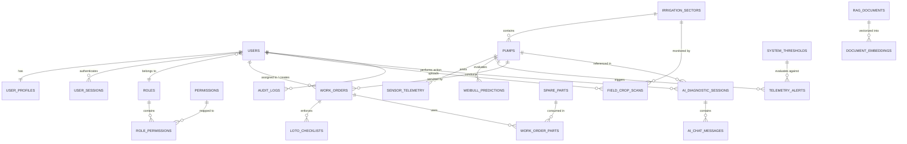

# خطة المعمارية الشاملة لقاعدة بيانات منصة AgriPulse
## AgriPulse Enterprise Database Architecture Plan & Data Contract

> **مشروع تخرج: هندسة الذكاء الاصطناعي — كلية الهندسة، جامعة المنصورة**  
> **المنصة:** AgriPulse — الذكاء الاصطناعي للصيانة التنبؤية والتوأم الرقمي لمحطات ضخ الري الزراعي  
> **المعيار الهندسي المرجعي:** ISO 10816-3 (الآلات الدوارة الصناعية من الفئة الثانية: 15kW – 75kW)  
> **محرك قاعدة البيانات:** PostgreSQL 16+ مع ملحقات TimescaleDB (أو BRIN Indexes للسلاسل الزمنية) + Redis للذاكرة المؤقتة  
> **طبقة الـ ORM في الباك إند:** SQLAlchemy 2.0 (Async) / Pydantic v2 / FastAPI  

---

## 📑 فهرس المحتويات

1. [المقدمة والرؤية الهندسية](#1-المقدمة-والرؤية-الهندسية)
2. [متطلبات الواجهة الأمامية والتحكم المركزي من الداشبورد](#2-متطلبات-الواجهة-الأمامية-والتحكم-المركزي-من-الداشبورد)
3. [مخطط الكيانات والعلاقات (Mermaid ERD)](#3-مخطط-الكيانات-والعلاقات-mermaid-erd)
4. [الهيكل التفصيلي للجداول والحقول (Data Dictionary)](#4-الهيكل-التفصيلي-للجداول-والحقول-data-dictionary)
   - 4.1 [نظام الهوية والمصادقة والبروفايل (Auth & User Profiles)](#41-نظام-الهوية-والمصادقة-والبروفايل)
   - 4.2 [الأصول الهيدروليكية والمضخات (Pump Assets & Digital Twin)](#42-الأصول-الهيدروليكية-والمضخات)
   - 4.3 [قطاعات الري والشبكات الزراعية (Irrigation Sectors)](#43-قطاعات-الري-والشبكات-الزراعية)
   - 4.4 [بيانات الحساسات والسلاسل الزمنية (Sensor Telemetry)](#44-بيانات-الحساسات-والسلاسل-الزمنية)
   - 4.5 [محرك التنبيهات ومعايير ISO 10816-3 (Alerts & Thresholds)](#45-محرك-التنبيهات-ومعايير-iso-10816-3)
   - 4.6 [تذاكر الصيانة وإجراءات السلامة LOTO (Work Orders & Safety)](#46-تذاكر-الصيانة-وإجراءات-السلامة-loto)
   - 4.7 [المساعد الذكي وقاعدة المعرفة RAG (AI Diagnostics & KB)](#47-المساعد-الذكي-وقاعدة-المعرفة-rag)
   - 4.8 [رؤية الحاسوب وتشخيص أمراض الأوراق (Field Vision Scans)](#48-رؤية-الحاسوب-وتشخيص-أمراض-الأوراق)
   - 4.9 [التحكم الديناميكي في الواجهة والمحتوى (CMS & Dynamic UI Settings)](#49-التحكم-الديناميكي-في-الواجهة-والمحتوى)
   - 4.10 [سجلات الرقابة والنشاط الشامل (Audit Logs)](#410-سجلات-الرقابة-والنشاط-الشامل)
5. [كود إنشاء الجداول (PostgreSQL DDL)](#5-كود-إنشاء-الجداول-postgresql-ddl)
6. [نماذج البرمجة في بايثون (SQLAlchemy 2.0 Async Models)](#6-نماذج-البرمجة-في-بايثون-sqlalchemy-20-async-models)
7. [البيانات الأولية للتغذية (Seed Data)](#7-البيانات-الأولية-للتغذية-seed-data)
8. [إستراتيجية الأداء والتخزين المؤقت (Redis & Caching)](#8-إستراتيجية-الأداء-والتخزين-المؤقت-redis--caching)

---

## 1. المقدمة والرؤية الهندسية

تعتمد شبكات الري الزراعي الحديثة والمشروعات القومية الزراعية (مثل الدلتا الجديدة، وتوشكى، ومستقبل مصر) على محطات ضخ هيدروليكية تعمل بمضخات طرد مركزي (*Grundfos NB / Kirloskar DB Series*). إن توقف هذه المضخات المفاجئ يسبب خسائر زراعية جسيمة قد تمتد لأيام وتتلف المحاصيل الاستراتيجية.

تم بناء هذه الخطة المعمارية لقاعدة البيانات لتكون **العمود الفقري المتين** لمنظومة AgriPulse، بحيث تحقق:
1. **التكامل الفوري والكامل بنسبة 100%** مع واجهة React 18 / Vite المدمجة وجميع صفحاتها (`HomePage`, `LiveOperationsPage`, `PredictiveIntelligencePage`, `AIDiagnosticsPage`, `FieldVisionPage`, `PumpAssetsPage`, `MaintenancePage`, `AnalyticsPage`, `SettingsPage`, `LoginScreen`).
2. **التحكم الديناميكي الشامل من لوحة تحكم المسؤول (Admin Dashboard CMS)** في كل معلومة أو مؤشر أو بطاقة أو زر أو نص يظهر في واجهة المستخدم، دون الحاجة لإعادة بناء (Rebuild) أو تعديل كود الفرونت إند.
3. **إدارة متقدمة للحسابات والمصادقة (Auth & RBAC)** تدعم مختلف الأدوار التشغيلية (مسؤول نظام، مهندس اعتمادية، مهندس زراعي، فني صيانة، مشغل محطة، زائر).
4. **تخزين فائق الكفاءة للسلاسل الزمنية (High-Throughput Timeseries)** لحساسات الاهتزاز والضغط والحرارة والتدفق والكهرباء بمعدلات سحب تصل لملايين القراءات أسبوعياً.

---

## 2. متطلبات الواجهة الأمامية والتحكم المركزي من الداشبورد

لضمان التحكم الكامل للمسؤول في كل عنصر بالواجهة، تم تصميم قاعدة البيانات لتغطي المحاور الإدارية التالية:

| المحور الإداري في الداشبورد | المكونات التي يتم التحكم بها في الواجهة | الجدول المسؤول في قاعدة البيانات |
|:---|:---|:---|
| **إدارة المستخدمين والصلاحيات** | تسجيل الدخول، إنشاء الحسابات، قفل وتفعيل الحسابات، منح الصلاحيات، وتعيين الأدوار | `users`, `roles`, `permissions`, `user_sessions` |
| **بروفايل الحسابات والشخصنة** | تعديل الاسم، كلمة المرور، الصورة الرمزية، القطاع المخصص، وتفضيلات الإشعارات واللغة | `user_profiles`, `user_notification_preferences` |
| **إدارة المضخات والأسطول** | إضافة/تعديل/أرشفة المضخات، تغيير الموديل، القدرة، التدفق، الموقع الجغرافي، والمخطط الهيكلي | `pumps`, `pump_models`, `pump_components` |
| **إدارة قطاعات الري والترع** | إضافة مناطق الري، المساحة بالهكتار، المحاصيل المزروعة، والضغوط التصميمية المستهدفة | `irrigation_sectors`, `sector_crops` |
| **معايرة عتبات ISO 10816-3** | تحديد حدود الاهتزاز (التحذير 4.5 mm/s والخطر 7.1 mm/s)، ودرجات الحرارة القصوى، وعناوين الـ Webhooks | `system_thresholds`, `iso_standards_calibration` |
| **أوامر الشغل وتذاكر الصيانة** | إنشاء وتعيين تذاكر الصيانة، تحديد الأولويات، بناء قوائم السلامة (LOTO)، وحساب التكاليف | `work_orders`, `loto_checklists`, `spare_parts` |
| **المساعد الذكي RAG والوثائق** | رفع وتصنيف أدلة التشغيل PDF/MD، إدارة الـ Chunks، واختيار نموذج الذكاء الاصطناعي | `rag_documents`, `ai_diagnostic_sessions`, `ai_chat_messages` |
| **فحص المحاصيل بالرؤية الحاسوبية** | إدارة سجلات فحص أمراض أوراق النبات YOLOv8، نسبة الثقة، وتحديد درجات الإجهاد المائي | `field_crop_scans`, `crop_disease_catalog` |
| **تخصيص واجهة المستخدم CMS** | إدارة الإعلانات العاجلة أعلى الواجهة، تفعيل/تعطيل صفحات معينة، وتحديد أهداف الـ KPIs الشهرية | `system_announcements`, `ui_navigation_items`, `fleet_kpi_targets` |
| **سجلات المراقبة والأمان** | تسجيل وتتبع أي تعديل يقوم به أي مستخدم مع حفظ القيمة القديمة والجديدة وعنوان الـ IP | `audit_logs` |

---

## 3. مخطط الكيانات والعلاقات (Mermaid ERD)

---

## 4. الهيكل التفصيلي للجداول والحقول (Data Dictionary)

### 4.1 نظام الهوية والمصادقة والبروفايل

#### جدول `roles` (أدوار النظام والصلاحيات)
يحدد الأدوار القياسية في المنظومة:
* `SUPER_ADMIN`: كامل الصلاحيات المطلقة وإعدادات الخادم والـ API Keys.
* `OPERATIONS_ADMIN`: مدير التشغيل والصيانة والتحكم في إعدادات الواجهة.
* `RELIABILITY_ENGINEER`: مهندس الاعتمادية المسؤول عن قراءات الاهتزاز والـ RUL.
* `AGRONOMIST`: المهندس الزراعي المسؤول عن قطاعات الري وفحص المحاصيل YOLOv8.
* `MAINTENANCE_TECH`: الفني الميداني المسؤول عن تذاكر الصيانة وإجراءات LOTO.
* `OPERATOR`: مشغل المحطة (مراقبة حية فقط وتسجيل ملاحظات).
* `VIEWER`: زائر/مراقب للمشروع بدون صلاحيات تعديل.

#### جدول `users` (الحسابات وبيانات الدخول)
* `id` (UUID, Primary Key): المعرف الفريد.
* `email` (VARCHAR(255), Unique, Indexed): البريد الإلكتروني لتسجيل الدخول.
* `password_hash` (VARCHAR(255)): تجزئة كلمة المرور بتقنية bcrypt أو Argon2id.
* `full_name` (VARCHAR(150)): الاسم الكامل للمستخدم.
* `role_id` (INTEGER, FK -> roles.id): الدور الوظيفي.
* `is_active` (BOOLEAN, Default: TRUE): حالة تفعيل الحساب.
* `is_verified` (BOOLEAN, Default: FALSE): تأكيد البريد الإلكتروني.
* `two_factor_enabled` (BOOLEAN, Default: FALSE): تفعيل المصادقة الثنائية 2FA.
* `two_factor_secret` (VARCHAR(255), Nullable): مفتاح الـ TOTP المشفر.
* `last_login_at` (TIMESTAMPTZ, Nullable): تاريخ ووقت آخر دخول ناجح.
* `created_at`, `updated_at` (TIMESTAMPTZ).

#### جدول `user_profiles` (بروفايل الحساب والتخصيص)
* `user_id` (UUID, PK, FK -> users.id CASCADE): معرّف المستخدم.
* `phone_number` (VARCHAR(30)): رقم الهاتف للتنبيهات العاجلة وSMS.
* `job_title` (VARCHAR(100)): المسمى الوظيفي (مثال: Lead Reliability Engineer).
* `avatar_url` (VARCHAR(500)): رابط الصورة الشخصية.
* `assigned_sector_id` (VARCHAR(50), FK -> irrigation_sectors.id, Nullable): القطاع المخصص افتراضياً لهذا المهندس.
* `preferred_language` (VARCHAR(5), Default: 'ar'): اللغة المفضلة ('ar' أو 'en').
* `theme_mode` (VARCHAR(20), Default: 'living_intelligence'): مظهر الواجهة.
* `bio` (TEXT): نبذة تعريفية أو تخصص المهندس.
* `updated_at` (TIMESTAMPTZ).

#### جدول `user_notification_preferences` (تفضيلات التنبيهات)
* `user_id` (UUID, PK, FK -> users.id CASCADE).
* `email_critical_alerts` (BOOLEAN, Default: TRUE).
* `email_warning_alerts` (BOOLEAN, Default: TRUE).
* `sms_emergency_alerts` (BOOLEAN, Default: FALSE).
* `push_notifications` (BOOLEAN, Default: TRUE).
* `daily_telemetry_digest` (BOOLEAN, Default: FALSE).

---

### 4.2 الأصول الهيدروليكية والمضخات

#### جدول `pumps` (سجل المضخات الصناعية)
يمثل المحرك الرئيسي لصفحات `PumpAssetsPage`, `LiveOperationsPage`, و`PredictiveIntelligencePage`:
* `id` (VARCHAR(50), PK): كود المضخة الهندسي (مثال: `P-04`, `P-01`).
* `name` (VARCHAR(150)): اسم المضخة المعروض بالواجهة (مثال: `Pump P-04 (Zone 2 Booster)`).
* `sector_id` (VARCHAR(50), FK -> irrigation_sectors.id): كود قطاع الري التابعة له.
* `model` (VARCHAR(100)): موديل المضخة (مثال: `Grundfos CR 95-2 High Flow`).
* `serial_number` (VARCHAR(100), Unique): الرقم التسلسلي للمصنع.
* `iso_machine_class` (VARCHAR(30), Default: 'Class II'): فئة الآلة طبقا لـ ISO 10816-3.
* `rated_power_kw` (NUMERIC(8, 2)): القدرة الكهربية المقننة بالكيلوواط (مثال: `45.00 kW`).
* `rated_speed_rpm` (INTEGER): السرعة الدورانية المقننة (مثال: `2950 RPM`).
* `rated_flow_lpm` (NUMERIC(10, 2)): معدل التدفق الاسمي باللتر/دقيقة.
* `rated_head_meters` (NUMERIC(8, 2)): الارتفاع الهيدروليكي الاسمي بالأمتار.
* `commissioning_date` (DATE): تاريخ بدء التشغيل الفعلي في المزرعة.
* `latitude` (NUMERIC(10, 7)), `longitude` (NUMERIC(10, 7)): الإحداثيات الجغرافية على الخريطة.
* `schematic_svg_url` (VARCHAR(500)): رابط المخطط الميكانيكي التفاعلي (Interactive Pump Schematic).
* `is_operational` (BOOLEAN, Default: TRUE): هل المضخة قيد الخدمة أم معطلة/مخرجة للصيانة.
* `current_status` (VARCHAR(20), Default: 'HEALTHY'): الحالة الحالية (`HEALTHY`, `WARNING`, `CRITICAL`, `STANDBY`, `OFFLINE`).
* `current_health_score` (INTEGER, Check: 0 <= score <= 100): مؤشر الصحة العام (0-100%).
* `current_rul_hours` (INTEGER): الساعات المتبقية المقدرة حتى الفشل (Weibull RUL).
* `current_failure_mode` (VARCHAR(255)): نمط العطل المحتمل (مثل: Inner Bearing Raceway Cavitation).
* `created_at`, `updated_at` (TIMESTAMPTZ).

---

### 4.3 قطاعات الري والشبكات الزراعية

#### جدول `irrigation_sectors` (قطاعات وشبكات الري)
* `id` (VARCHAR(50), PK): كود القطاع (مثال: `sector-delta-7`, `sector-alpha-3`).
* `name` (VARCHAR(150)): اسم القطاع (مثال: `Sector Delta-7`).
* `irrigation_type` (VARCHAR(100)): نوع شبكة الري (`High-Pressure Pivot Network`, `Subsurface Drip Irrigation`, `Canal Intake`).
* `area_hectares` (NUMERIC(10, 2)): المساحة الإجمالية بالهكتار.
* `target_crops` (VARCHAR(255)): المحاصيل الرئيسية المنزرعة (مثال: `Wheat, Alfalfa, Maize`).
* `nominal_pressure_bar` (NUMERIC(6, 2)): الضغط التشغيلي المستهدف (بار).
* `nominal_flow_lpm` (NUMERIC(10, 2)): التدفق الهيدروليكي المستهدف (لتر/دقيقة).
* `polygon_geojson` (JSONB, Nullable): حدود القطاع الجغرافية لرسمها على خريطة Leaflet.
* `created_at`, `updated_at` (TIMESTAMPTZ).

---

### 4.4 بيانات الحساسات والسلاسل الزمنية

#### جدول `sensor_telemetry` (القراءات الحية فائقة الدقة)
يدعم استقبال بيانات الـ ESP32 و SCADA لعرضها في الرسوم البيانية وصفحات التحليل:
* `id` (BIGSERIAL, PK): ترقيم تسلسلي.
* `pump_id` (VARCHAR(50), FK -> pumps.id, Indexed): كود المضخة.
* `recorded_at` (TIMESTAMPTZ, Indexed): وقت تسجيل العينة بدقة المللي ثانية.
* `vibration_rms_x` (NUMERIC(6, 3)): سرعة الاهتزاز الفعالة على المحور الأفقي (mm/s).
* `vibration_rms_y` (NUMERIC(6, 3)): سرعة الاهتزاز الفعالة على المحور الرأسي (mm/s).
* `vibration_rms_z` (NUMERIC(6, 3)): سرعة الاهتزاز الفعالة على المحور المحوري (mm/s).
* `vibration_rms_max` (NUMERIC(6, 3)): أقصى قيمة فعالة (المعتمدة لتقييم ISO 10816-3).
* `vibration_peak_g` (NUMERIC(6, 3)): تسارع الاهتزاز بالـ Peak (g).
* `bearing_temp_c` (NUMERIC(6, 2)): درجة حرارة كراسي التحميل (°C).
* `motor_casing_temp_c` (NUMERIC(6, 2)): درجة حرارة غلاف الموتور (°C).
* `suction_pressure_bar` (NUMERIC(6, 3)): ضغط السحب (بار) - فحص ظاهرة التكهف Cavitation.
* `discharge_pressure_bar` (NUMERIC(6, 3)): ضغط الطرد (بار).
* `flow_rate_lpm` (NUMERIC(10, 2)): معدل التدفق اللحظي (L/min).
* `current_amp` (NUMERIC(8, 2)): شدة التيار الكلي المسحوب (أمبير).
* `voltage_volts` (NUMERIC(8, 2)): الجهد الكهربائي بين الأطوار (فولت).
* `active_power_kw` (NUMERIC(8, 2)): القدرة الفعالة المستهلكة (كيلوواط).
* `frequency_hz` (NUMERIC(6, 2)): التردد الكهربي من الإنفرتر VFD (هرتز).
* `cavitation_index` (NUMERIC(6, 3)): نسبة التكهف (NPSHa / NPSHr).
* `fft_spectrum_json` (JSONB, Nullable): مصفوفة طيف الترددات السريعة (FFT Frequencies & Amplitudes).

---

### 4.5 محرك التنبيهات ومعايير ISO 10816-3

#### جدول `system_thresholds` (عتبات ومعايير النظام)
يتم التحكم فيه مباشرة من صفحة `SettingsPage` في الفرونت إند:
* `id` (INTEGER, PK, Default: 1): معرّف مفرد للإعدادات العامة.
* `vibration_warning_mm_s` (NUMERIC(5, 2), Default: 4.50): عتبة الإنذار Zone C (تحذير).
* `vibration_critical_mm_s` (NUMERIC(5, 2), Default: 7.10): عتبة الخطر Zone D (إيقاف وتدخل فوري).
* `temp_warning_c` (NUMERIC(5, 2), Default: 75.00): درجة حرارة التحذير.
* `temp_critical_c` (NUMERIC(5, 2), Default: 90.00): درجة حرارة الخطر.
* `suction_pressure_min_bar` (NUMERIC(5, 2), Default: 0.50): أدنى ضغط سحب قبل حدوث التكهف.
* `sampling_rate_ms` (INTEGER, Default: 2500): الفاصل الزمني بين قراءات الحساسات (بالمللي ثانية).
* `alert_email` (VARCHAR(255)): البريد الإلكتروني الافتراضي لاستلام الإنذارات.
* `webhook_url` (VARCHAR(500)): رابط Webhook للتكامل مع أنظمة SCADA الخارجية.
* `auto_create_work_orders` (BOOLEAN, Default: TRUE): إنشاء تذكرة صيانة تلقائياً عند وصول المضخة لحالة CRITICAL.
* `updated_by` (UUID, FK -> users.id): المستخدم الذي قام بآخر معايرة.
* `updated_at` (TIMESTAMPTZ).

#### جدول `telemetry_alerts` (سجل الإنذارات الحية)
* `id` (VARCHAR(50), PK): معرّف الإنذار (مثال: `ALT-9041`).
* `pump_id` (VARCHAR(50), FK -> pumps.id): المضخة المعنية.
* `severity` (VARCHAR(20)): مستوى الإنذار (`CRITICAL`, `WARNING`, `INFO`).
* `title` (VARCHAR(200)): عنوان الإنذار (مثال: `ISO 10816 Zone D Vibration Breach`).
* `description` (TEXT): تفاصيل الإنذار وسبب الظهور.
* `triggered_value` (NUMERIC(8, 2)): القيمة التي تسببت في إطلاق التنبيه (مثال: 7.84 mm/s).
* `threshold_limit` (NUMERIC(8, 2)): الحد الأقصى المسموح به (مثال: 7.10 mm/s).
* `is_acknowledged` (BOOLEAN, Default: FALSE): هل تم تأكيد رؤية التنبيه من المهندس.
* `acknowledged_by` (UUID, FK -> users.id, Nullable).
* `acknowledged_at` (TIMESTAMPTZ, Nullable).
* `is_resolved` (BOOLEAN, Default: FALSE): هل تم حل المشكلة وإغلاق التنبيه.
* `created_at` (TIMESTAMPTZ).

---

### 4.6 تذاكر الصيانة وإجراءات السلامة LOTO

#### جدول `work_orders` (تذاكر الصيانة وأوامر الشغل الميدانية)
يدعم بالكامل صفحة `MaintenancePage`:
* `id` (VARCHAR(50), PK): كود أمر الشغل (مثال: `WO-2026-088`).
* `pump_id` (VARCHAR(50), FK -> pumps.id): كود المضخة المطلوب صيانتها.
* `title` (VARCHAR(200)): عنوان التذكرة (مثال: `Urgent Bearing Replacement & Dynamic Balancing`).
* `description` (TEXT): شرح وافٍ للعطل وإرشادات الفريق الفني.
* `priority` (VARCHAR(20)): الأولوية (`EMERGENCY`, `HIGH`, `MEDIUM`, `LOW`).
* `status` (VARCHAR(30), Default: 'OPEN'): الحالة (`OPEN`, `IN_PROGRESS`, `PENDING_PARTS`, `COMPLETED`, `CANCELLED`).
* `assigned_to` (UUID, FK -> users.id, Nullable): الفني أو المهندس المسؤول عن التنفيذ.
* `created_by` (UUID, FK -> users.id): منشئ التذكرة (سواء مهندس أو النظام الذكي تلقائياً).
* `due_date` (TIMESTAMPTZ): الموعد النهائي المقترح لإنهاء الصيانة.
* `completed_at` (TIMESTAMPTZ, Nullable): تاريخ ووقت الإنجاز الفعلي.
* `estimated_hours` (NUMERIC(6, 2)): الساعات المتوقعة للعمل.
* `actual_downtime_hours` (NUMERIC(6, 2), Nullable): عدد ساعات توقف المضخة الفعلي.
* `total_cost` (NUMERIC(12, 2), Default: 0.00): التكلفة الإجمالية (قطع غيار + مصنعية).
* `created_at`, `updated_at` (TIMESTAMPTZ).

#### جدول `loto_checklists` (قوائم عزل الطاقة والسلامة المهنية LOTO)
* `id` (UUID, PK): معرّف فحص السلامة.
* `work_order_id` (VARCHAR(50), FK -> work_orders.id CASCADE): تذكرة الصيانة المرتبطة.
* `step_number` (INTEGER): ترتيب الخطوة (1, 2, 3...).
* `step_title` (VARCHAR(255)): عنوان خطوة العزل (مثال: `Isolate 380V Main Circuit Breaker`).
* `is_verified` (BOOLEAN, Default: FALSE): هل قام الفني بتنفيذ الخطوة وتأكيدها.
* `verified_by` (UUID, FK -> users.id, Nullable): توقيع الفني الرقمي.
* `verified_at` (TIMESTAMPTZ, Nullable): وقت تنفيذ إجراء السلامة.

---

### 4.7 المساعد الذكي وقاعدة المعرفة RAG

#### جدول `rag_documents` (أدلة التشغيل ومكتبة المعرفة الفنية)
يدعم صفحة `DocumentsLibrary`, `DocsPage`, و محرك RAG لـ `AIDiagnosticsPage`:
* `id` (UUID, PK): معرّف الوثيقة.
* `title` (VARCHAR(255)): عنوان الوثيقة (مثال: `Grundfos CR-95 Installation & Maintenance Manual`).
* `slug` (VARCHAR(255), Unique): الرابط اللطيف للملف.
* `category` (VARCHAR(100)): التصنيف (`O&M Manual`, `ISO Standard`, `FMEA Matrix`, `SOP`).
* `file_url` (VARCHAR(500)): مسار تحميل ملف الـ PDF الأصلي.
* `content_markdown` (TEXT): النص المستخرج أو المحتوى بصيغة Markdown.
* `total_chunks` (INTEGER, Default: 0): عدد المقاطع النصية المجزأة لـ Embeddings.
* `vector_collection_name` (VARCHAR(100), Default: 'agripulse_knowledge'): اسم مجموعة الفيكتور في ChromaDB/pgvector.
* `is_indexed` (BOOLEAN, Default: TRUE): هل تم توليد التضمينات وتمت الفهرسة بنجاح.
* `created_at`, `updated_at` (TIMESTAMPTZ).

#### جدول `ai_diagnostic_sessions` و `ai_chat_messages`
يدعم محادثات واستفسارات `AIDiagnosticsPage`:
* تخزين جلسات التشخيص، والمضخة المستهدفة، وتاريخ الرسائل، وسياق الـ Telemetry المصاحب للمحادثة.

---

### 4.8 رؤية الحاسوب وتشخيص أمراض الأوراق

#### جدول `field_crop_scans` (سجلات فحص الكاميرات ورؤية الحاسوب)
يدعم بالكامل صفحة `FieldVisionPage`:
* `id` (VARCHAR(50), PK): معرّف الفحص (مثال: `SCAN-2026-104`).
* `sector_id` (VARCHAR(50), FK -> irrigation_sectors.id): قطاع الري الذي تم التقاط الصورة فيه.
* `associated_pump_id` (VARCHAR(50), FK -> pumps.id, Nullable): المضخة المسؤولة عن تغذية هذه المساحة.
* `image_url` (VARCHAR(500)): رابط الصورة الأصلية الملتقطة.
* `annotated_image_url` (VARCHAR(500)): رابط الصورة بعد وضع مربعات الكشف والتصنيف Bounding Boxes.
* `primary_diagnosis` (VARCHAR(100)): التشخيص الأبرز (مثل: `Early Foliar Blight`, `Water Stress Wilt`, `Healthy Canopy`).
* `confidence_score` (NUMERIC(5, 4)): نسبة الثقة في التشخيص (مثال: `0.9420`).
* `severity_level` (VARCHAR(20)): درجة الخطورة (`LOW`, `MODERATE`, `HIGH`, `CRITICAL`).
* `water_stress_correlation` (NUMERIC(5, 2)): معامل ارتباط الإجهاد المائي بنقص ضغط المضخة (0 - 100%).
* `detections_json` (JSONB): مصفوفة الكشوفات التفصيلية من نموذج YOLOv8.
* `uploaded_by` (UUID, FK -> users.id, Nullable): المهندس الذي رفع الصورة (أو NULL إذا جاءت من كاميرا إنترنت الأشياء IoT).
* `scanned_at` (TIMESTAMPTZ, Default: NOW()).

---

### 4.9 التحكم الديناميكي في الواجهة والمحتوى (CMS & Dynamic UI Settings)

هذا الجزء يجيب مباشرة على متطلب المستخدم: **"التحكم ف كل الحاجة ف الواجهة من الداشبورد"**:

#### جدول `system_announcements` (الشريط الإعلاني والتنبيهات العامة للواجهة)
يتحكم في ظهور أو إخفاء البانر الإعلاني أعلى واجهة المستخدم:
* `id` (UUID, PK): معرّف الإعلان.
* `title` (VARCHAR(200)): عنوان البانر (مثال: `تنبيه: انقطاع مجدول للتيار الكهربائي في قطاع دلتا-7 غداً`).
* `message` (TEXT): نص الرسالة التوضيحية للمهندسين والمشغلين.
* `banner_type` (VARCHAR(20), Default: 'INFO'): نوع الشريط ولونه (`INFO`, `WARNING`, `CRITICAL`, `SUCCESS`).
* `is_active` (BOOLEAN, Default: TRUE): تفعيل أو إيقاف العرض فوراً.
* `target_roles` (JSONB): الأدوار المستهدفة برؤية البانر (أو `["ALL"]` لجميع المستخدمين).
* `starts_at` (TIMESTAMPTZ), `ends_at` (TIMESTAMPTZ): فترة العرض المجدولة.
* `created_by` (UUID, FK -> users.id).

#### جدول `ui_navigation_items` (التحكم في القائمة الجانبية وصفحات الواجهة)
يتيح لمسؤول النظام إخفاء أو إظهار أو إعادة ترتيب أي صفحة في الواجهة ديناميكياً:
* `id` (VARCHAR(50), PK): معرّف الصفحة (مثل: `nav_field_vision`, `nav_copilot`).
* `title_ar` (VARCHAR(100)): الاسم المعروض بالعربية.
* `title_en` (VARCHAR(100)): الاسم المعروض بالإنجليزية.
* `route_path` (VARCHAR(100)): مسار الصفحة في React Router (مثل: `/field-vision`).
* `icon_name` (VARCHAR(50)): اسم أيقونة Lucide (مثل: `Eye`, `Activity`, `Cpu`).
* `sort_order` (INTEGER): ترتيب العنصر في القائمة الجانبية (Sidebar).
* `is_visible` (BOOLEAN, Default: TRUE): إظهار أو إخفاء الصفحة من القائمة.
* `required_role` (VARCHAR(50), Default: 'VIEWER'): أقل دور وظيفي يسمح له برؤية الصفحة.

#### جدول `fleet_kpi_targets` (الأهداف التشغيلية المعروضة في شاشات الإحصائيات)
يتحكم في البطاقات والأرقام المستهدفة في صفحة `HomePage` و `AnalyticsPage`:
* `id` (INTEGER, PK, Default: 1).
* `target_monthly_power_kwh` (NUMERIC(12, 2)): السقف المستهدف لاستهلاك الكهرباء.
* `target_monthly_water_m3` (NUMERIC(12, 2)): الحصة المستهدفة من مياه الري.
* `max_allowed_downtime_hours` (NUMERIC(8, 2)): الحد الأقصى المسموح به للتوقف المفاجئ للمضخات شهرياً.
* `target_fleet_health_score` (INTEGER, Default: 85): النسبة المستهدفة لمتوسط صحة الأسطول.

---

### 4.10 سجلات الرقابة والنشاط الشامل

#### جدول `audit_logs` (سجل الرقابة الكامل لكافة تعديلات لوحة التحكم)
يسجل تلقائياً أي تغيير يجريه أي مستخدم عبر التريجرز (Triggers) في قاعدة البيانات أو عبر الـ Middleware في FastAPI:
* `id` (BIGSERIAL, PK): ترقيم السجل.
* `user_id` (UUID, FK -> users.id, Nullable): المستخدم الفاعل.
* `action` (VARCHAR(30)): نوع الحدث (`CREATE`, `UPDATE`, `DELETE`, `LOGIN`, `LOGOUT`, `CALIBRATE`).
* `entity_type` (VARCHAR(50)): الكيان المعدل (`PUMP`, `USER`, `SETTING`, `WORK_ORDER`, `ANNOUNCEMENT`).
* `entity_id` (VARCHAR(100)): معرّف الكيان المعدل.
* `old_values` (JSONB, Nullable): القيم السابقة قبل التعديل.
* `new_values` (JSONB, Nullable): القيم الجديدة بعد التعديل.
* `ip_address` (VARCHAR(45)): عنوان الـ IP الذي تم منه الإجراء.
* `user_agent` (VARCHAR(500)): المتصفح أو التطبيق المستخدم.
* `created_at` (TIMESTAMPTZ, Default: NOW()).

---

## 5. كود إنشاء الجداول (PostgreSQL DDL)

الملف الكامل متاح ومحفوظ في مسار المشروع:  
[`backend/database/schema.sql`](file:///d:/doc/python/grad%20pro%203/backend/database/schema.sql)

ويتضمن إنشاء الجداول مع القيود وفهارس الـ Indexes المحسنة للسلاسل الزمنية.

---

## 6. نماذج البرمجة في بايثون (SQLAlchemy 2.0 Async Models)

الملف الكامل متاح ومحفوظ في مسار المشروع:  
[`backend/database/models.py`](file:///d:/doc/python/grad%20pro%203/backend/database/models.py)

ويتضمن كافة نماذج الكائنات (Classes) مع العلاقات (Relationships) والتحقق من الأنواع بـ Type Hints ليتصل مباشرة بتطبيق FastAPI.

---

## 7. البيانات الأولية للتغذية (Seed Data)

الملف الكامل متاح ومحفوظ في مسار المشروع:  
[`backend/database/seed_data.sql`](file:///d:/doc/python/grad%20pro%203/backend/database/seed_data.sql)

ويحتوي على:
1. حسابات افتراضية كاملة (SuperAdmin و مهندس الاعتمادية طارق منصور).
2. المضخات الفعلية المطابقة للفرونت إند (`P-01`, `P-02`, `P-03`, `P-04`, `P-05`, `P-06`).
3. قطاعات الري الثلاثة (`sector-delta-7`, `sector-alpha-3`, `sector-gamma-12`).
4. المعايرة القياسية لـ ISO 10816-3.
5. أوامر الشغل الميدانية والتنبيهات وعناصر تحكم الواجهة.

---

## 8. إستراتيجية الأداء والتخزين المؤقت (Redis & Caching)

لضمان سرعة فائقة تضاهي الـ Mock Data السريعة جداً في الواجهة:
1. **Redis Caching لمؤشرات الأسطول (`GET /dashboard/overview`)**:
   - يتم تخزين ناتج الإحصائيات في الذاكرة المؤقتة بمفتاح `cache:dashboard:overview` لمدة 5 ثوانٍ، ويتم تجديدها تلقائياً عند وصول قراءات جديدة.
2. **WebSocket Pub/Sub للتحديث اللحظي للمضخات**:
   - قناة `telemetry:pumps:live` لنقل قراءات الاهتزاز والضغط مباشرة إلى صفحة `LiveOperationsPage` دون عمل Polling مستمر على قاعدة البيانات.
3. **Partitioning للسلاسل الزمنية (Sensor Telemetry)**:
   - تقسيم جدول `sensor_telemetry` شهرياً (Monthly Range Partitions) لضمان بقاء سرعة الاستعلامات تحت 15 مللي ثانية حتى مع تراكم ملايين السجلات.
