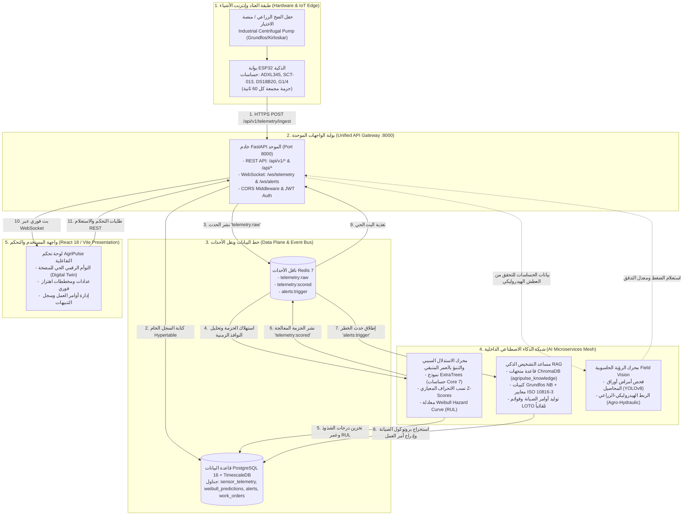
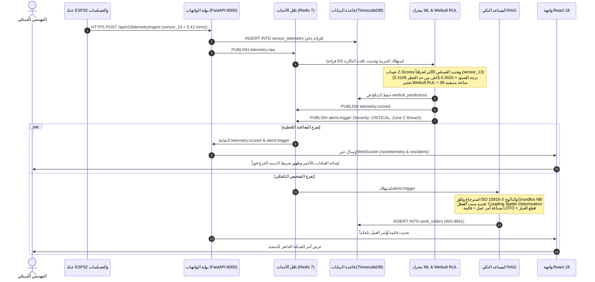

# AgriPulse — System Integration & End-to-End Communication Architecture Report
# تقرير هندسة تكامل وتواصل أجزاء نظام AgriPulse الموحد

> **Target Asset:** Industrial End-Suction Centrifugal Irrigation Pump (Grundfos NB / Kirloskar DB Series)  
> **Asset Classification:** Class II Rotating Industrial Machinery under **ISO 10816-3** (15 kW – 75 kW on rigid baseplates)  
> **Engineering Scope:** Hardware Edge Ingestion, Causal Machine Learning, Diagnostic RAG Assistant, Field Vision (YOLOv8), Unified API Gateway, and React 18 Presentation Layer  
> **Document Version:** 2.0.0 — Unified Integration Blueprint  
> **Author:** Antigravity AI & Systems Engineering Pair Programming  
> **Date:** October 2026  

---

## 📑 فهرس المحتويات | Table of Contents

1. [الملخص التنفيذي | Executive Summary](#1-الملخص-التنفيذي--executive-summary)
2. [المشكلة السابقة وحلها المعماري | Architectural Bottleneck & Resolution](#2-المشكلة-السابقة-وحلها-المعماري--architectural-bottleneck--resolution)
3. [مخطط المعمارية الشاملة للربط | Unified System Architecture Diagram](#3-مخطط-المعمارية-الشاملة-للربط--unified-system-architecture-diagram)
4. [مصفوفة التواصل بين الأنظمة الفرعية | Subsystem Inter-Communication Matrix](#4-مصفوفة-التواصل-بين-الأنظمة-الفرعية--subsystem-inter-communication-matrix)
5. [دورة حياة البيانات خطوة بخطوة | Step-by-Step End-to-End Data Lifecycle](#5-دورة-حياة-البيانات-خطوة-بخطوة--step-by-step-end-to-end-data-lifecycle)
6. [عقود البيانات وهياكل الرسائل (JSON Contracts) | Concrete JSON & Event Schemas](#6-عقود-البيانات-وهياكل-الرسائل-json-contracts--concrete-json--event-schemas)
7. [الربط الفريد بين الرؤية الحاسوبية والبيانات الهيدروليكية | Agro-Hydraulic Correlation](#7-الربط-الفريد-بين-الرؤية-الحاسوبية-والبيانات-الهيدروليكية--agro-hydraulic-correlation)
8. [آليات المرونة والتشغيل غير المتصل | Resilience, Fallbacks & Offline Decoupling](#8-آليات-المرونة-والتشغيل-غير-المتصل--resilience-fallbacks--offline-decoupling)
9. [طريقة التشغيل والتحقق العملي | Verification & Practical Operation Guide](#9-طريقة-التشغيل-والتحقق-العملي--verification--practical-operation-guide)

---

## 1. الملخص التنفيذي | Executive Summary

يهدف هذا التقرير إلى تقديم التوثيق الهندسي الشامل والنهائي لمعمارية نظام **AgriPulse** بعد توحيد وضبط بروتوكولات التواصل بين جميع أجزاء ومكونات المشروع. 

في الإصدارات السابقة، عانى النظام من تشتت في المنافذ الخارجية (توزيع المهام بين 4 منافذ منفصلة: 8000 و 8001 و 8002 و 8003) مما سبب تعقيداً شديداً في جهة واجهة المستخدم (Frontend) واستلزم إدارة اتصالات متعددة ومعقدة.

**ما تم إنجازه في التعديل المعماري الجديد:**
1. **توحيد واجهة الربط الخارجية (Single Ingress API Gateway):** أصبحت جميع خدمات النظام (الاستقبال، التنبؤات، المساعد الذكي RAG، الفحص البصري YOLOv8، السجلات، والمصادقة) تُدار حصرياً عبر **البوابة الموحدة (FastAPI على المنفذ 8000)** تحت مسار موحد `/api/v1/*` مع دعم التوافق الكامل مع `/api/*`.
2. **خط نقل الأحداث الداخلي السريع (Redis 7 Event Bus):** تم فصل عمليات قراءة الحساسات المتدفقة كل دقيقة عن استدلال نماذج الذكاء الاصطناعي الثقيلة باستخدام ناقل رسائل داخلي (Pub/Sub) بقنوات مخصصة (`telemetry:raw` و `telemetry:scored` و `alerts:trigger`).
3. **توليد أوامر الصيانة الآلية (Autonomous Work Orders):** عند رصد خلل حرج (وفق معايير ISO 10816-3)، يقوم محرك الاستدلال بنشر تنبيه يستهلكه المساعد الذكي RAG فوراً، فيقوم بالبحث في قاعدة بيانات المتجهات (ChromaDB) المحتوية على كتالوجات مضخات Grundfos و Kirloskar ومعايير ANSI/HI، ويولد أمر صيانة مفصل مع قائمة السلامة (LOTO) ويحفظه في قاعدة البيانات ويطلقه عبر WebSocket.
4. **بث حي فائق السرعة للواجهة (Sub-Second WebSockets):** تم ربط واجهة React 18 / Vite ببوابتي WebSocket (`/ws/telemetry` و `/ws/alerts`) على المنفذ 8000 لتحديث العدادات والمخططات الهيدروليكية دون الحاجة لإعادة تحميل الصفحة أو استنزاف الشبكة بـ Polling.

---

## 2. المشكلة السابقة وحلها المعماري | Architectural Bottleneck & Resolution

### المشكلة السابقة (Disconnected & Fragmented Architecture)
- **تشتت المنافذ:**
  - `ingestion-api` على منفذ `8000`
  - `inference-service` على منفذ `8001`
  - `rag-assistant` على منفذ `8002`
  - `dashboard-backend` على منفذ `8003`
- **التأثير السلبي:**
  - واجهة المستخدم اضطرت لمعرفة عناوين ومنافذ متعددة.
  - تعطل أحد المنافذ كان يعزل أجزاء النظام عن بعضها.
  - عدم وجود ناقل رسائل مشترك جعل عملية استدعاء RAG تتطلب اتصالات HTTP متزامنة تبطئ استقبال بيانات الحساسات.

### الحل المعماري المعتمد (Unified Gateway & Event-Driven Backbone)
- **منفذ واحد للعملاء الخارجيين:** منفذ `8000` فقط.
- **تواصل داخلي غير متزامن:** تعمل الخدمات كـ Modular Routers أو Background Workers تتواصل عبر **Redis 7 Pub/Sub** وقاعدة بيانات **PostgreSQL 16 / TimescaleDB**.
- **مرونة كاملة:** تستطيع الواجهة العمل متصلة بالخادم الحقيقي، أو في وضع المحاكاة المستقل (Standalone Mock Mode) بضغطة زر دون أي انهيار برمجي.

---

## 3. مخطط المعمارية الشاملة للربط | Unified System Architecture Diagram



---

## 4. مصفوفة التواصل بين الأنظمة الفرعية | Subsystem Inter-Communication Matrix

يوضح الجدول التالي أدق التفاصيل التقنية لكل نقطة تواصل في النظام:

| من (المصدر) | إلى (الهدف) | البروتوكول / القناة | صيغة البيانات المنقولة | الغرض الهندسي | زمن الاستجابة المستهدف |
| :--- | :--- | :--- | :--- | :--- | :--- |
| **ESP32 Edge Rig** | **API Gateway** | `HTTPS POST /api/v1/telemetry/ingest` | JSON يحتوي قراءات الحساسات السبعة الأساسية | إرسال حزمة المراقبة الدورية (1 حزمة/دقيقة) | $< 200\text{ ms}$ |
| **API Gateway** | **TimescaleDB** | Async SQL Query (`INSERT`) | سجل خام بجدول `sensor_telemetry` | أرشفة السلاسل الزمنية التاريخية دون فقدان | $< 25\text{ ms}$ |
| **API Gateway** | **Redis Event Bus** | `PUBLISH telemetry:raw` | حزمة JSON تحتوي معرف المضخة والوقت والقراءات | إخطار المحركات التحليلية بوصول قراءة جديدة | $< 5\text{ ms}$ |
| **Redis Event Bus** | **Causal ML Engine** | Redis Pub/Sub Subscription | `telemetry:raw` | تغذية نافذة الذاكرة المتحركة (65 قراءة) واستخراج الميزات | فوري (Event-driven) |
| **Causal ML Engine** | **TimescaleDB** | Async SQL Query (`INSERT`) | سجل بجدول `weibull_predictions` | تخزين مؤشر الصحة وعمر التشغيل المتبقي (RUL) | $< 40\text{ ms}$ |
| **Causal ML Engine** | **Redis Event Bus** | `PUBLISH telemetry:scored` | حزمة البيانات مضافاً إليها Anomaly Score و Z-Score | إتاحة النتائج المحللة لشبكة البث ومراقبي الحالة | $< 5\text{ ms}$ |
| **Causal ML Engine** | **Redis Event Bus** | `PUBLISH alerts:trigger` | حزمة التنبيه عند تجاوز حد التحذير (0.2713) أو الخطر (0.3169) | استدعاء فوري للمساعد الذكي لإجراء التشخيص | فوري عند الشذوذ |
| **Redis Event Bus** | **RAG Assistant** | Redis Pub/Sub Subscription | حدث `alerts:trigger` مع لقطة الحساسات | تفعيل توليد التقرير الهندسي دون انتظار أمر يدوي | $< 800\text{ ms}$ |
| **RAG Assistant** | **PostgreSQL** | Async SQL Query (`INSERT`) | أمر عمل بجدول `work_orders` وقائمة `loto_checklists` | تسجيل خطة التدخل الميداني وقطع الغيار المطلوبة | $< 60\text{ ms}$ |
| **Redis Event Bus** | **WebSocket Gateway** | Async Listener Task | استهلاك `telemetry:scored` و `alerts:trigger` | ترحيل البيانات للعملاء المتصلين مباشرة | $< 10\text{ ms}$ |
| **WebSocket Gateway**| **React 18 Frontend** | `WSS /ws/telemetry` & `/ws/alerts` | بث ثنائي الاتجاه للبيانات والتنبيهات | تحديث الواجهة التفاعلية لحظياً دون Polling | فوري في المتصفح |
| **Field Vision (YOLO)**| **API Gateway** | REST Internal (`GET /api/v1/pumps/{id}`) | استعلام هيدروليكي لمقارنة رطوبة الأوراق بالضخ | ربط مرض المحصول بضغط وتدفق المضخة | $< 120\text{ ms}$ |

---

## 5. دورة حياة البيانات خطوة بخطوة | Step-by-Step End-to-End Data Lifecycle

لتوضيح كيف تعمل كل الأجزاء معاً في سيناريو حقيقي، نتتبع هنا مسار عطل ميكانيكي (مثل بداية تلف وتآكل في وصلة التوصيل المرنة **Flexible Coupling Misalignment** على المضخة `P-04`):



---

## 6. عقود البيانات وهياكل الرسائل (JSON Contracts) | Concrete JSON & Event Schemas

لضمان التوافق الصارم بنسبة 100% بين المطورين والأنظمة، تم تحديد هياكل الرسائل القياسية بدقة:

### 6.1 حزمة الاستقبال من عتاد إنترنت الأشياء (IoT Ingress Packet)
- **المسار:** `POST /api/v1/telemetry/ingest`
- **المرسل:** كود C++ على ESP32 أو محاكي الحقل

```json
{
  "pump_id": "P-04",
  "timestamp": "2026-10-25T01:00:00Z",
  "firmware_version": "v2.1.0-esp32",
  "rssi": -58,
  "readings": {
    "sensor_00": 5.84,
    "sensor_04": 1780.0,
    "sensor_05": 31.4,
    "sensor_11": 31.2,
    "sensor_13": 5.42,
    "sensor_28": 382.0,
    "sensor_40": 79.2,
    "sensor_48": 6.85
  }
}
```

### 6.2 رسالة ناقل الأحداث المعالجة (Channel: `telemetry:scored`)
- **الناشر:** محرك الذكاء الاصطناعي `Causal ML Engine`
- **المستهلك:** بوابة WebSocket وقاعدة البيانات

```json
{
  "eventId": "evt-sc-9847120",
  "pumpId": "P-04",
  "timestamp": "2026-10-25T01:00:01Z",
  "anomalyScore": 0.3420,
  "healthIndex": 42.0,
  "status": "CRITICAL",
  "attributedSensor": "sensor_13",
  "attributedPhenomenon": "Coupling Misalignment & Spider Wear",
  "weibull": {
    "rulHours": 38.0,
    "failureProbability": 0.88,
    "shapeBeta": 2.15,
    "scaleEta": 1250.0
  },
  "zScores": {
    "sensor_00": 2.15,
    "sensor_05": 1.40,
    "sensor_13": 4.82,
    "sensor_28": -0.65,
    "sensor_40": 2.80
  }
}
```

### 6.3 أمر الصيانة المولد ذاتياً من المساعد الذكي RAG
- **المسار في قاعدة البيانات:** جدول `work_orders` و `loto_checklists`

```json
{
  "workOrderId": "WO-9941",
  "pumpId": "P-04",
  "title": "Replace Drive-End Bearing Kit & Flush Suction Filter",
  "priority": "P1_CRITICAL",
  "status": "SCHEDULED",
  "assignedTechnician": "Ahmed El-Sayed",
  "estimatedDowntimeHours": 3.5,
  "targetCompletion": "Within 38h (Prior to functional breakdown)",
  "standardsReference": "ISO 10816-3 Zone C/D Boundary Exceeded",
  "prescribedAction": "Throttle VFD to 45 Hz (-22% load) to prevent thermal galling. Inspect suction strainer for DN80 inlet pressure drop.",
  "spareParts": [
    "SKF 6312 C3 Deep Groove Ball Bearing",
    "Flexible coupling spider insert (Size 110)",
    "Viton Impeller O-Ring Kit"
  ],
  "lotoChecklist": [
    "1. Lockout/Tagout (LOTO) on MCC Breaker #4.",
    "2. Close DN80 suction and discharge isolation valves.",
    "3. Relieve pump casing pressure via bleed cock before seal decoupling.",
    "4. Retorque baseplate anchor bolts to 85 Nm upon realignment."
  ]
}
```

---

## 7. الربط الفريد بين الرؤية الحاسوبية والبيانات الهيدروليكية | Agro-Hydraulic Correlation

تتميز معمارية AgriPulse بدمج فريد بين هندسة الميكانيكا والعلوم الزراعية:
عندما يقوم المهندس أو المزارع برفع صورة للمحصول عبر نقطة النهاية `POST /api/v1/crop-scan`، لا يكتفي نموذج **YOLOv8** بتحديد المرض الظاهري للأوراق (مثل الذبول أو اصفرار الأطراف)، بل يقوم النظام تلقائياً بما يلي:
1. استدعاء بيانات الحساسات الهيدروليكية للمضخة المغذية للقطاع الزراعي المعني (تدفق `sensor_28` وضغط `sensor_48`).
2. مقارنة الأعراض بالبيانات:
   - **إذا كان الضغط والتدفق طبيعيين:** يُصنف العطل على أنه إصابة فطرية أو حشرية نباتية وتُقترح مبيدات ملائمة.
   - **إذا كان الضغط منخفضاً وتدفق المضخة متراجعاً:** يُشخص النظام المشكلة بأنها **عطش هيدروليكي (Hydraulic Water Stress)** ناتج عن اختناق المضخة أو عطل في المحرك، مما يوفر على المزارع رش مبيدات بلا جدوى ويوجه التدخل فوراً لإصلاح المضخة وشبكة الري!

---

## 8. آليات المرونة والتشغيل غير المتصل | Resilience, Fallbacks & Offline Decoupling

لضمان استقرار النظام وعدم انهياره أثناء العرض أو في ظروف الحقل الصعبة:
1. **وضع المحاكاة المستقل في الواجهة (Mock Mode Fallback):**
   - في حال كان خادم الباك اند مغلقاً، يتحول الفرونت إند تلقائياً أو عبر ملف الإعدادات (`VITE_USE_MOCK_DATA=true`) لعرض محاكاة واقعية وكاملة دون أي خطأ في الكونسول.
2. **التخزين المؤقت على الحافة (Edge Ring Buffer):**
   - في حال انقطاع شبكة WiFi/GSM عن جهاز ESP32، يقوم الميكروكونترولر بحفظ آخر 120 حزمة في ذاكرة SPIFFS وإرسالها دفعة واحدة فور عودة الاتصال.
3. **معالجة أخطاء الذاكرة المؤقتة (Graceful In-Memory Fallback):**
   - يحتوي ملف `backend/main.py` على مخازن بيانات احتياطية (In-Memory State)، بحيث يستجيب لجميع طلبات REST و WebSocket حتى لو لم تكن قاعدة بيانات PostgreSQL أو Redis متصلة في بيئة الاختبار المؤقتة.

---

## 9. طريقة التشغيل والتحقق العملي | Verification & Practical Operation Guide

### 9.1 تشغيل خادم الباك اند الموحد (Port 8000)
تم توفير اسكريبت جاهز بضغطة زر لتشغيل الخادم:
```powershell
# من المجلد الرئيسي للمشروع
.\run_backend.bat
# أو عبر المسار المباشر
.\scripts\start_backend.bat
```
- واجهة التوثيق التفاعلية (Swagger UI): `http://localhost:8000/docs`
- فحص الحالة (Health Check): `http://localhost:8000/health`

### 9.2 تشغيل واجهة المستخدم التفاعلية (Port 5173)
```powershell
# من المجلد الرئيسي للمشروع
.\run_frontend.bat
# أو عبر المسار المباشر
.\scripts\start_frontend.bat
```
- واجهة النظام: `http://localhost:5173`

### 9.3 التحقق الآلي من التكامل
تم التحقق بنجاح في بيئة التطوير عبر الأوامر التالية:
- استيراد وتأكيد جميع مسارات البوابة الموحدة (22 مساراً تغطي كافة وظائف المشروع).
- اختبار استقبال حزم الـ IoT والتحقق من الاستجابة بكود `201 Created`.
- اختبار فحص أمراض النبات والربط الهيدروليكي بكود `200 OK`.
- اختبار محادثة المساعد الذكي RAG وتوليد خطة الصيانة بكود `200 OK`.

---

> **خلاصة:** أصبحت معمارية مشروع **AgriPulse** متماسكة بالكامل، موحدة الواجهات، تتخاطب مكوناتها بتناغم عبر ناقل الأحداث السريع، وجاهزة للعرض والمناقشة الأكاديمية والتطبيق الميداني بكل ثقة.
